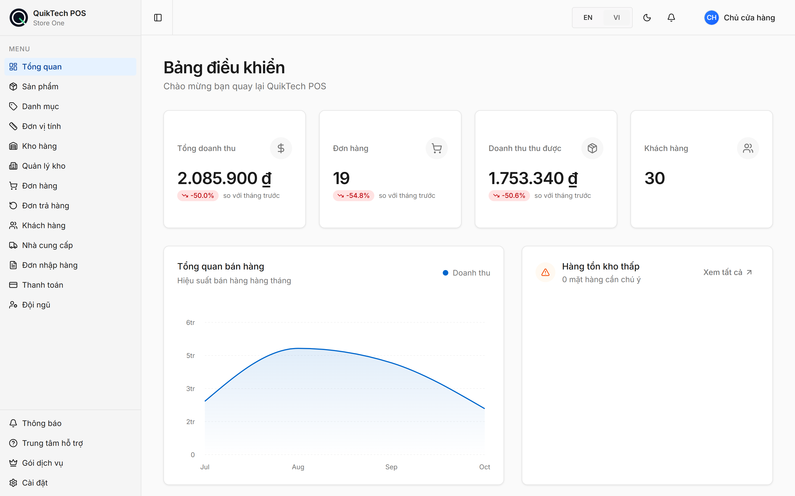

# QuikTech POS — Web

Giao diện web cho **QuikTech POS**: phần mềm bán hàng, quản lý kho và công nợ cho doanh nghiệp nhỏ, nhiều cửa hàng, hỗ trợ tiếng Việt và tiếng Anh.

- Demo: [pos.nhatnguyenhuynh.com](https://pos.nhatnguyenhuynh.com)
- Backend: [NguyenAlpha/omniflow-backend](https://github.com/NguyenAlpha/omniflow-backend)



## Tech stack

- **Next.js 16** (App Router), **React 19**, **TypeScript**
- **Tailwind CSS 4**, shadcn/ui (Radix UI), lucide-react
- Recharts (biểu đồ), react-hook-form + zod (form), @zxing/browser (quét mã vạch)
- Vitest (unit test), ESLint 9
- **pnpm** (npm bị chặn trong `package.json`)

## Chức năng

- **Landing page** và đăng ký / đăng nhập, tạo doanh nghiệp lần đầu (`/setup`)
- **Bán hàng:** tạo đơn, quét mã vạch, thanh toán, trả hàng
- **Kho:** sản phẩm, danh mục, đơn vị tính, nhiều kho, chuyển kho, điều chỉnh tồn, import CSV
- **Nhập hàng** từ nhà cung cấp
- **Khách hàng & nhà cung cấp:** theo dõi công nợ, ghi nhận thanh toán
- **Dashboard** doanh thu, đơn hàng; xuất Excel
- **Đội ngũ:** thành viên và vai trò theo cửa hàng
- **Gói dịch vụ** Free / Basic / Pro, nâng cấp bằng chuyển khoản QR
- **Trang quản trị hệ thống** tại `/admin` (đăng nhập riêng)
- Song ngữ VI / EN, giao diện sáng / tối

## Chạy local

**Yêu cầu:** Node.js 20.9+ và pnpm.

```bash
pnpm install
pnpm dev
```

Mở http://localhost:3000.

Web gọi backend qua biến `NEXT_PUBLIC_API_URL`, mặc định là `http://localhost:8080`. Hãy chạy backend local theo README của [repo backend](https://github.com/NguyenAlpha/omniflow-backend), hoặc trỏ tới backend khác bằng file `.env.local`:

```bash
# .env.local (gitignored)
NEXT_PUBLIC_API_URL=https://quiktech-pos-api-8217b2.azurewebsites.net
```

> Giữ port **3000**. Backend chỉ cho phép CORS từ các origin trong `CORS_ORIGINS`, mặc định là `http://localhost:3000`.

Với dữ liệu mẫu của backend, đăng nhập bằng `user1` / `password` để có sẵn sản phẩm, đơn hàng và khách hàng.

## Scripts

| Lệnh | Mô tả |
|:--|:--|
| `pnpm dev` | Chạy dev server |
| `pnpm build` | Build production |
| `pnpm start` | Chạy bản đã build |
| `pnpm lint` | ESLint |
| `pnpm test` | Unit test (Vitest) cho `lib/` |

## Deploy

Bản demo deploy trên **Vercel** từ nhánh `main`:

1. Đặt biến môi trường `NEXT_PUBLIC_API_URL` trỏ tới backend.
2. Thêm domain của web vào `CORS_ORIGINS` của backend, nếu không trình duyệt sẽ chặn mọi request.

## Cấu trúc thư mục

```text
app/
├── page.tsx         landing page
├── (auth)/          đăng nhập, đăng ký, setup
├── (dashboard)/     các trang quản lý cửa hàng
└── admin/           trang quản trị hệ thống
components/          component dùng chung (ui/ là shadcn/ui)
lib/                 API client, auth, i18n (translations.ts), tiện ích
hooks/               React hooks
public/              logo, ảnh landing page
docs/                tài liệu
```

## Tài liệu

| Tài liệu | Nội dung |
|:--|:--|
| [OVERVIEW](docs/OVERVIEW.md) · [ARCHITECTURE](docs/ARCHITECTURE.md) | Tổng quan, kiến trúc |
| [FEATURES](docs/FEATURES.md) | Danh sách tính năng |
| [API](docs/API.md) · [DATA_FLOW](docs/DATA_FLOW.md) | Gọi API, luồng dữ liệu |
| [AUTH](docs/AUTH.md) | Xác thực, phiên đăng nhập |
| [COMPONENTS](docs/COMPONENTS.md) | Component |
| [I18N](docs/I18N.md) | Đa ngôn ngữ |
| [ADMIN_UI](docs/ADMIN_UI.md) | Trang quản trị |
| [PRODUCTS](docs/PRODUCTS.md) · [NOTIFICATIONS](docs/NOTIFICATIONS.md) · [PAYMENT_ACCOUNTS](docs/PAYMENT_ACCOUNTS.md) | Tính năng cụ thể |
| [RATE_LIMITING](docs/RATE_LIMITING.md) | Xử lý giới hạn request |
